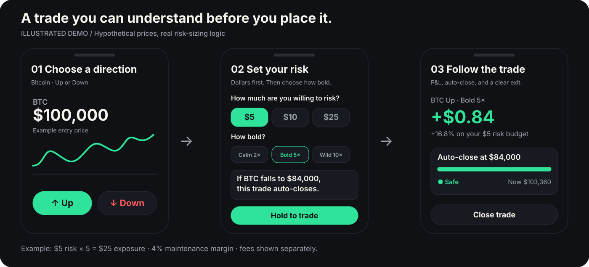
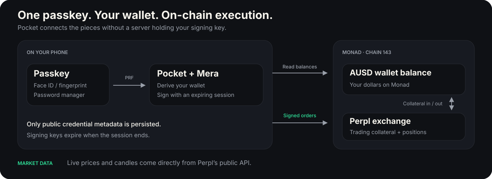

<p align="center">
  <picture>
    <source media="(prefers-color-scheme: dark)" srcset="mobile-app/assets/brand/pocket-wordmark-dark.png" />
    
  </picture>
</p>

<h1 align="center">Your money. Your risk. Your Pocket.</h1>

<p align="center">
  Trade in dollars. Decide how much to risk.<br />
  <strong>Monad Metropolis · Onchain Finance &amp; Trading</strong>
</p>

<p align="center">
  <a href="#try-the-demo">Try the demo</a> ·
  <a href="#how-it-works">How it works</a> ·
  <a href="#built-on-monad">The stack</a> ·
  <a href="#run-the-mobile-app">Run locally</a>
</p>

Pocket is a mobile trading app built on Monad. Instead of starting with a leverage
slider, you choose a dollar risk budget and a trading style: **Calm 2×**, **Bold 5×**,
or **Wild 10×**. The ticket shows the position size, estimated auto-close price,
and fees before you hold to trade.

Accounts use Mera passkeys, balances use Agora's AUSD, and live orders connect to
Perpl. Pocket's account layer keeps signing keys on the device, without a custody
backend.



_Illustrated Demo walkthrough. The example uses a $100,000 BTC entry,
$5 risk at 5×, and 4% maintenance margin; estimated auto-close is $84,000. Fees are separate._

## Why Pocket?

Trading apps often lead with charts, leverage, and margin terminology. Pocket starts
with a question people already understand: **“How much am I willing to risk?”**

The answer becomes a dollar budget, a position size, and an estimated auto-close
price. You see those numbers together before making a decision.

## How it works

| Choose                                | Understand                                                       | Act                                                                   |
| ------------------------------------- | ---------------------------------------------------------------- | --------------------------------------------------------------------- |
| Pick a market and **Up** or **Down**. | Set your dollar risk and choose **Calm**, **Bold**, or **Wild**. | Review the estimate, hold to trade, then track or close the position. |

## What you can do

- Follow live market prices and charts for BTC, ETH, MON, and other Perpl markets.
- Practice with **$1,000 in Demo mode**, using live prices and simulated trades.
- Choose Up or Down, set a risk budget, and preview the trade in plain language.
- Track P&L, distance to auto-close, receipts, and activity.
- Create or unlock an account with a passkey in a native development build.
- Switch between Demo and Live from the You tab.

The interface follows the device's light or dark theme, with Inter typography and
Pocket's mint, coral, amber, and violet accents.

## Try the demo

Choose **Try Demo with $1,000** on Welcome, then:

1. Open **BTC**, choose **Up**, and select **$5 · Bold 5×**.
2. Read the auto-close sentence and open **Details** to inspect the risk math.
3. Hold to open, watch the risk meter, close the trade, and check the receipt in **Activity**.

The You tab lets you reset the demo and switch modes. Prices are live; Demo funds
and execution are simulated.

## Demo and Live

| Mode | Funds                                         | Execution                              |
| ---- | --------------------------------------------- | -------------------------------------- |
| Demo | $1,000 of play money                          | Paper trades against live Perpl prices |
| Live | AUSD in a passkey-derived wallet; MON for gas | On-chain Perpl transactions            |

Demo runs in Expo Go. Live account and trading flows are implemented, but passkey
verification on a device and a funded end-to-end trading round trip remain pending.

The risk budget is the trade's sizing input. Live funding also accounts for exchange
minimums, fees, and a collateral buffer. A recorded mainnet probe found a **10 AUSD
minimum opening/deposit** and a **0.01 AUSD minimum withdrawal**; current values are
read from Perpl. Exact loss-limit behavior still needs verification with real fills,
funding, and withdrawals.

## Built on Monad



| Integration      | What it does                                                                 |
| ---------------- | ---------------------------------------------------------------------------- |
| **Mera**         | Turns a passkey into a standard EVM account and an expiring signing session. |
| **AUSD · Agora** | Provides the dollar-denominated wallet balance and exchange collateral.      |
| **Perpl**        | Supplies market data and the on-chain perpetuals exchange.                   |
| **Monad · viem** | Connects the app to chain 143 for balance reads and signed transactions.     |

The native app calls Perpl and Monad directly. Signing happens on the device;
there is no custody server between the user and their wallet.

## Project structure

```text
mobile-app/                Expo app for Android, iOS, and a browser preview
  app/                     Screens and navigation
  components/              Shared UI and trading components
  hooks/                   Market data, portfolio, and theme hooks
  lib/account/             Passkeys, wallet derivation, and signing sessions
  lib/perpl/               Market data, ABI, account reads, and trading
  scripts/                 Read-only probe and passkey association tools
  theme/                   Pocket branding and light/dark colors
web/                       Separate React Router web app foundation
```

The mobile app uses **Expo SDK 57**, **React Native**, **Expo Router**,
**Gluestack UI**, **NativeWind**, **TanStack Query**, **Mera**, and **viem**.
It reads Perpl's public API directly and connects to **Monad mainnet, chain 143**.

## Run the mobile app

Use Node.js 24 or newer and Bun. From the repository root:

```bash
cd mobile-app
bun install
cp .env.example .env
bunx expo start --go
```

Open the app in an Expo Go version compatible with SDK 57 and choose
**Try Demo with $1,000**. Demo uses live market data, so it needs an internet
connection.

The [environment template](mobile-app/.env.example) includes public RPC and Perpl
defaults. Set `EXPO_PUBLIC_RPC_URL` for your preferred Monad RPC and
`EXPO_PUBLIC_RP_ID` to the permanent HTTPS hostname used for passkeys.
`EXPO_PUBLIC_*` values are bundled into the app; never put private keys in them.

## Native passkeys

Passkeys require a native development build. Before creating accounts, choose a
permanent rpId and serve the app's domain association files with the correct signing
certificate fingerprints. Changing the rpId later changes which passkeys the app
can access.

See the [passkey setup instructions](mobile-app/scripts/README.md) and
[association metadata template](mobile-app/scripts/passkey-association.example.json).

With the Android development environment configured:

```bash
APP_VARIANT=development bun run android
```

Alternatively, use the configured EAS profiles from `mobile-app`:

```bash
bun run build:android:development
bun run build:android:preview
```

Signing sessions expire on sign-out, after 60 seconds in the background, or after
10 minutes of inactivity. Only public credential metadata is persisted; PRF outputs
and private keys are not stored.

## Checks

Run from `mobile-app`:

```bash
bun test
bunx tsc --noEmit
bun run lint
bunx expo-doctor
bun run probe:perpl
```

The Perpl probe reads contract configuration without signing or submitting
transactions. Its [recorded snapshot](mobile-app/scripts/fixtures/perpl-probe-2026-10-14.json)
documents the observed values, rather than serving as trading configuration.

## Web development

The separate `web` project uses React Router, TypeScript, Tailwind CSS, and shadcn/ui:

```bash
cd web
bun install
bun run dev
```

Use `bun run typecheck` and `bun run build` inside `web` to check it.
